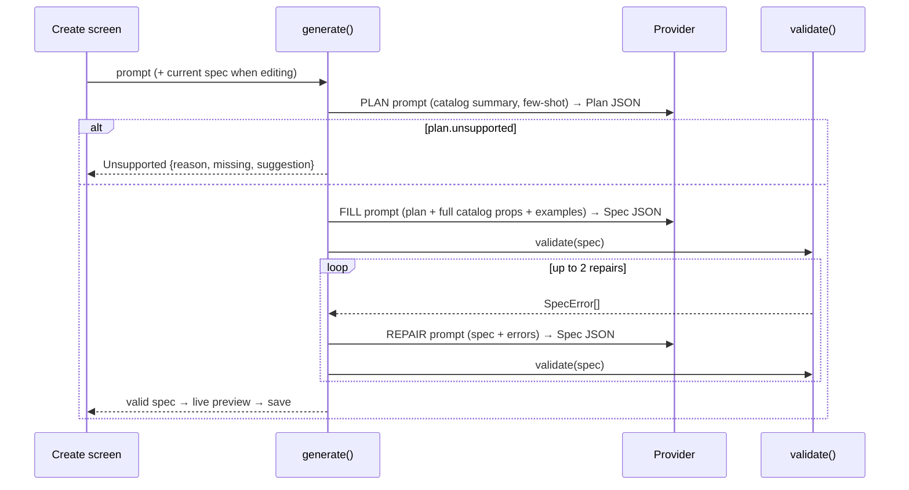

# JackApp — Architecture

This document defines **how the system is built and which boundaries must never be crossed**. If code and this document disagree, fix one of them in the same commit and log why in `DECISIONS.md`.

---

## 1. One-paragraph overview

JackApp is a single **Expo (React Native + React Native Web)** TypeScript app that ships to **web (PWA)** and **Android**, with iOS possible from the same code. A user prompt goes to a **generator** that asks an **open model (Gemma 4 or Qwen3.5)** for a **mini-app spec** (JSON, see `SCHEMA.md`). The spec is **validated**, then rendered by a **runtime** that maps spec elements to **pre-built components** (see `COMPONENTS.md`). Mini-apps can call the model again at runtime through the `ai.run` action. All data stays on the device. There is no backend.


## 2. Tech stack

| Concern | Choice | Notes |
|---|---|---|
| App framework | Expo (current stable SDK), Expo Router, TypeScript `strict` | Record the exact SDK version in `DECISIONS.md` ADR-001 at setup |
| Web | React Native Web via Expo (`npx expo start --web`, `npx expo export -p web`) | Static export; installable PWA |
| Validation | Zod | One schema source for validation **and** the JSON Schema sent to the model |
| State (per mini-app) | Small custom store (`useSyncExternalStore`) | No Redux; keep it tiny |
| Persistence | `@react-native-async-storage/async-storage` | Works on web (localStorage) and native |
| Images | `expo-image-picker`, `expo-image-manipulator` | Downscale to ≤ 1024 px JPEG before storing or sending to a model |
| Notifications | `expo-notifications` (native) | Web: best-effort, only while the tab is open |
| Tests | `jest-expo`, `@testing-library/react-native` | |
| Inference | Android: Gemma 4 E2B on the phone via LiteRT-LM (`modules/litert-lm`, default). Web and Android: `fetch` to OpenRouter (free models) or the user's Ollama server | ADR-021, ADR-022 |
| Inference: tests / agents | `mock` provider | Tests never call OpenRouter or Ollama |
| Optional renderer lib | Vercel `json-render` | Spike T-13 decides (ADR-005). Our spec stays canonical either way |

## 3. Directory layout

```
jackapp/
├── AGENTS.md  CLAUDE.md  ROADMAP.md  README.md
├── docs/                      # PRD, ARCHITECTURE, SCHEMA, COMPONENTS, TASKS, TESTING, DECISIONS, PROGRESS
├── app.json  eas.json  package.json  tsconfig.json
├── evals/
│   ├── prompts.json           # 30 eval prompts with expectations
│   └── results/               # timestamped JSON results (committed)
└── src/
    ├── app/                   # Expo Router routes (UI shell only)
    │   ├── index.tsx          # Home: my mini-apps + templates
    │   ├── create.tsx         # Prompt → generate → preview → save
    │   ├── run/[id].tsx       # Run a mini-app
    │   ├── edit/[id].tsx      # Edit-by-chat
    │   ├── settings.tsx       # AI choice: OpenRouter key / Ollama address + model
    │   └── dev/               # hidden dev screens, run on the phone
    │       └── eval.tsx       # runs generator/eval.ts with the chosen provider, shares results JSON
    ├── spec/                  # THE CONTRACT. No React imports here.
    │   ├── types.ts           # TS types inferred from Zod
    │   ├── schema.ts          # Zod schemas (structure)
    │   ├── validate.ts        # structural + semantic validation → SpecError[]
    │   ├── values.ts          # $ref, templates, $agg, $math, $now, formatters
    │   └── fixtures/          # hero specs + invalid specs (used by tests and templates)
    ├── runtime/               # Executes a validated spec
    │   ├── Renderer.tsx       # flat element map → React tree
    │   ├── store.ts           # per-app state, persistence
    │   ├── actions.ts         # action engine (closed op set)
    │   └── triggers.ts        # schedule → local notifications
    ├── catalog/               # One folder per component
    │   └── <Component>/       # props.ts (Zod) · <Component>.tsx · meta.ts (model hint + example)
    ├── ai/
    │   ├── provider.ts        # LLMProvider interface + registry
    │   ├── providers/
    │   │   ├── mock.ts
    │   │   ├── openrouter.ts      # default; one free model per stage
    │   │   ├── ollama.ts          # user's own server
    │   │   ├── litert.native.ts   # on-device Gemma 4 E2B (Android); litert.ts is the web stub
    │   │   └── logged.ts          # withLog(provider): call events for the eval log
    │   └── generator/
    │       ├── catalogPrompt.ts   # builds the catalog section of prompts from catalog/*/meta.ts
    │       ├── prompts.ts         # system prompts + few-shot examples
    │       ├── plan.ts  fill.ts  repair.ts
    │       ├── generate.ts        # orchestrates the pipeline, emits progress events
    │       └── eval.ts            # pure TS eval runner, any provider (tested with mock)
    ├── capabilities/          # camera, share, notifications — platform-split where needed
    ├── storage/               # mini-app library CRUD
    └── ui/                    # app-shell components (not mini-app components)
```

## 4. Hard boundaries (never cross)

1. **Specs are data, never code.** No `eval`, `new Function`, dynamic `import()` of spec content, `dangerouslySetInnerHTML`, or WebView rendering of model output. The only "logic" in a spec is the closed op set and value expressions in `SCHEMA.md`. (ADR-002)
2. **Every spec is untrusted** until `validate()` returns no errors: on generation, on load from storage, and on import.
3. **`src/spec/` has no React or platform imports.** It must run in Node (tests, eval runner).
4. **`src/runtime/` never imports `src/ai/generator/`.** The runtime only knows the `LLMProvider` interface, for `ai.run`.
5. **Catalog components never call AI or storage directly.** They get props and callbacks from the runtime.
6. **Platform differences live in `.web.ts` / `.native.ts` files** behind one interface. No `Platform.OS` branching in feature code, except for small UI tweaks.
7. **No network calls** except the AI provider the user picked in Settings (on-device, OpenRouter, or their Ollama address) and the one-time model download from huggingface.co. No analytics, no telemetry. The Ollama address is the only user-set URL.
8. **No new dependency** without a line in `DECISIONS.md` saying why.

## 5. LLM provider interface

```ts
export interface LLMProvider {
  id: 'mock' | 'openrouter' | 'ollama' | 'local';
  label: string;
  caps: { vision: boolean; jsonSchema: boolean; contextTokens: number };
  isConfigured(): Promise<boolean>;         // key / model name set in Settings
  generate(req: {
    system: string;
    messages: { role: 'user' | 'assistant'; content: string; images?: string[] }[]; // images: data URLs
    jsonSchema?: object;                    // used when caps.jsonSchema is true
    maxTokens?: number;
    temperature?: number;
    stage?: 'plan' | 'fill' | 'repair' | 'run'; // OpenRouter picks a model per stage
    signal?: AbortSignal;
    onPartial?(chars: number): void;        // streaming progress (on-device only)
    onLog?(message: string): void;          // provider internals for the eval log
  }): Promise<string>;                      // raw text; callers parse and validate
}
```

- **mock**: returns fixtures by keyword. Used by tests, UI work, and agents.
- **openrouter**: `src/ai/providers/openrouter.ts`. Key from Settings. Model per stage from `src/ai/models.ts` plus named fallbacks (`OPENROUTER_FALLBACKS`) and low reasoning effort. A `jsonSchema` request becomes `response_format: json_object` (PLAN only, ADR-017; strict schemas fail on Nvidia). Retries 429 with backoff. See ADR-021.
- **local** (Android): `src/ai/providers/litert.native.ts` calls the Expo module `modules/litert-lm` (Kotlin, LiteRT-LM 0.16.1). GPU first, CPU fallback; one conversation per call; `caps.jsonSchema` false; the model file (2.6 GB) is downloaded from huggingface.co at a pinned revision and size-checked (`localModel`). ADR-022.
- **ollama**: `src/ai/providers/ollama.ts`. `POST <ollamaUrl>/api/chat`, `format` = schema, images as bare base64.

## 6. Generation pipeline



Rules:
- Progress events: `planning`, `building`, `checking`, `repairing(n)`, `done`, `failed`, `unsupported`.
- Parse defensively: strip code fences, take the first top-level JSON object. Failure → error `BAD_JSON` → goes to repair.
- Temperatures: plan 0.4, fill 0.2, repair 0.0.
- The catalog text in prompts is **generated from `catalog/*/meta.ts`**, never hand-copied. `COMPONENTS.md` documents the same data for humans; a test checks they stay in sync.
- **Edit-by-chat** reuses FILL and REPAIR with the current spec as input. It must keep existing `state` keys whose type didn't change, so user data survives.

## 7. Runtime

- **Renderer**: looks up `screens[current].root` in `elements`, renders recursively. Unknown types can't occur (the validator blocks them). An error boundary per element shows a small "this part broke" card, not a crash.
- **Store**: one store per mini-app instance. Initial state comes from `state[*].default`. Keys with `persist !== false` are saved (debounced 500 ms) under `jackapp:data:<appId>`.
- **Actions**: steps run sequentially. Any step error stops the action and shows a toast. While an action runs, buttons that trigger it show a busy state. `ai.run` has a 120 s timeout and is abortable.
- **Value resolution** (`spec/values.ts`) is pure and synchronous, and is shared by the renderer, action engine, and triggers.
- **Triggers**: on save or app start, (re)schedule native local notifications for each trigger. Tapping a notification opens `run/[id]`.

## 8. Storage layout

| Key | Value |
|---|---|
| `jackapp:apps` | index: `[{id, name, icon, updatedAt}]` |
| `jackapp:spec:<id>` | the spec JSON |
| `jackapp:data:<id>` | persisted state for that mini-app |
| `jackapp:settings` | model choice (E2B/E4B/Qwen3.5-2B) |

## 9. Platform matrix

| Capability | Web | Android | iOS (later) |
|---|---|---|---|
| Render + state + persistence | ✅ | ✅ | ✅ |
| Camera / library | ✅ library + camera via browser | ✅ | ✅ |
| AI (OpenRouter / Ollama) | ✅ | ✅ | ⏳ |
| AI (on-device LiteRT-LM) | ❌ | ✅ | ⏳ |
| Scheduled notifications | ⚠️ only while open | ✅ | ✅ |

## 10. Performance and size budgets

- Spec ≤ 32 KB. Render of a 60-element spec < 100 ms on a mid-range phone.
- Images downscaled to ≤ 1024 px before storage and before `ai.run`.
- Web JS bundle (excluding model weights) ≤ 3 MB.
- Generation (plan + fill + repairs) median ≤ 90 s.

## 11. Security notes

- Specs are imported only after validation. Bad imports are rejected with readable errors.
- Template rendering produces **plain text** only. No HTML, no markdown links that open URLs.
- No URL fields anywhere. The only external traffic is to the AI provider chosen in Settings; it receives the request text and any photo `ai.run` reads, never saved apps or other data.
- No secrets in the repo. The OpenRouter key lives in on-device storage only and is never logged.

### Trust boundaries (T-62, updated by ADR-021)

Store restoration validates image values against the existing state schema before either image renderer can see them; defaults survive rejected values. The web worker and vendored runtime were removed in ADR-021.

## 12. Deployment

- **Web**: `npm run export:web` → GitHub Pages at `https://ru-das.github.io/jackapp/` via `.github/workflows/pages.yml` (ADR-019). Base path comes from `app.json` `experiments.baseUrl`; `+html.tsx` and `local.web.ts` read `EXPO_BASE_URL`. `public/manifest.webmanifest` uses relative `start_url`/`scope`. Workflow copies `index.html` to `404.html` so deep links (`/run/<id>`) reach the client router. Moving to a .tech root domain: remove `baseUrl`.
- **Android**: EAS Build `preview` profile with `"buildType": "apk"`. Attach the APK to a GitHub release.
- **iOS / stores**: after the challenge (ADR-006).

## 13. Generator eval interface (T-60)

`runEval(provider, model, { noPlan?, only?, onResult? } = {})` (`only` is one id or a list, e.g. `QUICK_IDS`)` in
`src/ai/generator/eval.ts` runs the corpus sequentially through `generate()`.
The caller supplies a selected, loaded provider; the runner imports its type only
and never loads/downloads models or touches storage. Unknown prompt ids reject
before inference; generation failures remain rows and the suite continues.
`onResult(row)` receives a copied row after each prompt; observer exceptions are
logged without stopping the run. The returned object is JSON-serializable:
`startedAt`, `finishedAt` (ISO), `provider`, `model`, normalized `options`
(`noPlan: false`, `only: null` by default), `rows`, `metrics`, `targets`, `topErrors`.
Rows retain corpus expectations/requirements, `durationMs`, full `result`,
`firstFillValid`, `missingRequirements: {components, ops}`, and stage/attempt error
`diagnostics`. See TESTING §2 for scoring.

`generate({..., noPlan: true})` starts at FILL with no plan payload; default is
still PLAN → FILL. Both modes preserve validation, metadata stamping, refusal,
cancellation and the shared two-repair limit. `repairing` and `failed` progress
events include copied `errors: SpecError[]`; other events omit diagnostics.
Observers cannot mutate validation/repair feedback through these snapshots.
