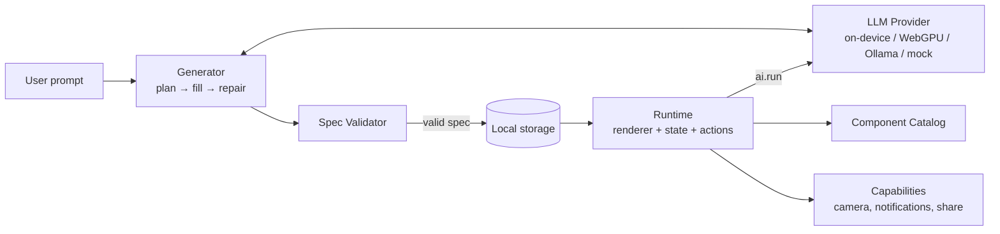
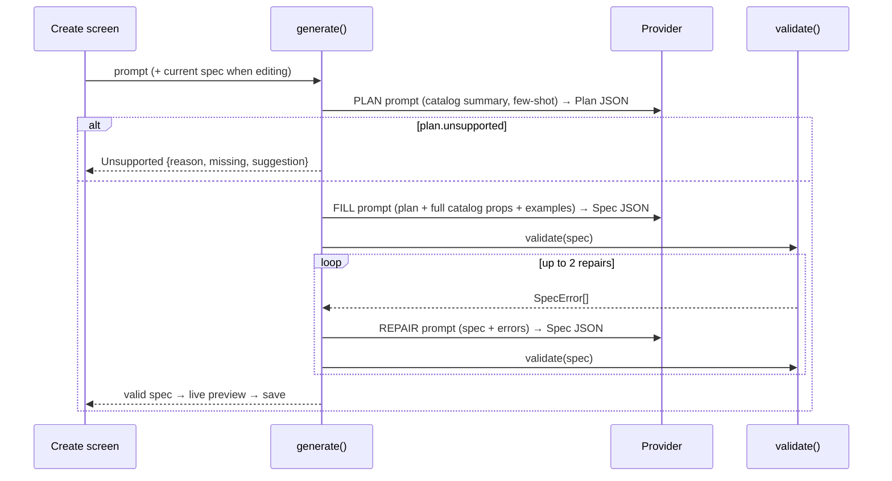

# JackApp — Architecture

This document defines **how the system is built and which boundaries must never be crossed**. If code and this document disagree, fix one of them in the same commit and log why in `DECISIONS.md`.

---

## 1. One-paragraph overview

JackApp is a single **Expo (React Native + React Native Web)** TypeScript app that ships to **web (PWA)** and **Android**, with iOS possible from the same code. A user prompt goes to a **generator** that asks an **open model (Gemma 4)** for a **mini-app spec** (JSON, see `SCHEMA.md`). The spec is **validated**, then rendered by a **runtime** that maps spec elements to **pre-built components** (see `COMPONENTS.md`). Mini-apps can call the model again at runtime through the `ai.run` action. All data stays on the device. There is no backend.



## 2. Tech stack

| Concern | Choice | Notes |
|---|---|---|
| App framework | Expo (current stable SDK), Expo Router, TypeScript `strict` | Record the exact SDK version in `DECISIONS.md` ADR-001 at setup |
| Web | React Native Web via Expo (`npx expo start --web`, `npx expo export -p web`) | Static export; installable PWA |
| Validation | Zod | One schema source for validation **and** the JSON Schema sent to the model |
| State (per mini-app) | Small custom store (`useSyncExternalStore`) | No Redux; keep it tiny |
| Persistence | `@react-native-async-storage/async-storage` | Works on web (localStorage) and native |
| Images | `expo-image-picker`, `expo-image-manipulator` | Downscale to ≤ 1024 px JPEG before storing or sending to a model |
| Notifications | `expo-notifications` (native) | Web: best-effort, only while the tab is open |
| Tests | `jest-expo`, `@testing-library/react-native` | |
| Inference: web | Transformers.js (`@huggingface/transformers`) with WebGPU, in a Web Worker | Spike T-11 decides feasibility |
| Inference: Android | `react-native-executorch` (fallback: `llama.rn`) | Needs a dev build, not Expo Go. Spike T-12 decides |
| Inference: any platform | Ollama HTTP API on a user-supplied URL | Always available; the eval harness uses it |
| Optional renderer lib | Vercel `json-render` | Spike T-13 decides (ADR-005). Our spec stays canonical either way |

## 3. Directory layout

```
jackapp/
├── AGENTS.md  CLAUDE.md  ROADMAP.md  README.md
├── docs/                      # PRD, ARCHITECTURE, SCHEMA, COMPONENTS, TASKS, TESTING, DECISIONS, PROGRESS
├── app.json  eas.json  package.json  tsconfig.json
├── scripts/
│   └── eval.ts                # eval harness (Node, Ollama provider)
├── evals/
│   ├── prompts.json           # 30 eval prompts with expectations
│   └── results/               # timestamped JSON results (committed)
└── src/
    ├── app/                   # Expo Router routes (UI shell only)
    │   ├── index.tsx          # Home: my mini-apps + templates
    │   ├── create.tsx         # Prompt → generate → preview → save
    │   ├── run/[id].tsx       # Run a mini-app
    │   ├── edit/[id].tsx      # Edit-by-chat
    │   └── settings.tsx       # Provider + model management
    ├── spec/                  # THE CONTRACT. No React imports here.
    │   ├── types.ts           # TS types inferred from Zod
    │   ├── schema.ts          # Zod schemas (structure)
    │   ├── validate.ts        # structural + semantic validation → SpecError[]
    │   ├── values.ts          # $ref, templates, $agg, $math, $now, formatters
    │   └── fixtures/          # hero specs + invalid specs (used by tests and templates)
    ├── runtime/               # Executes a validated spec
    │   ├── Renderer.tsx       # flat element map → React tree
    │   ├── store.ts           # per-app state, persistence
    │   ├── actions.ts         # action engine (closed op set)
    │   └── triggers.ts        # schedule → local notifications
    ├── catalog/               # One folder per component
    │   └── <Component>/       # props.ts (Zod) · <Component>.tsx · meta.ts (model hint + example)
    ├── ai/
    │   ├── provider.ts        # LLMProvider interface + registry
    │   ├── providers/
    │   │   ├── mock.ts
    │   │   ├── ollama.ts
    │   │   ├── local.web.ts       # Transformers.js worker client
    │   │   └── local.native.ts    # ExecuTorch / llama.rn
    │   └── generator/
    │       ├── catalogPrompt.ts   # builds the catalog section of prompts from catalog/*/meta.ts
    │       ├── prompts.ts         # system prompts + few-shot examples
    │       ├── plan.ts  fill.ts  repair.ts
    │       └── generate.ts        # orchestrates the pipeline, emits progress events
    ├── capabilities/          # camera, share, notifications — platform-split where needed
    ├── storage/               # mini-app library CRUD
    └── ui/                    # app-shell components (not mini-app components)
```

## 4. Hard boundaries (never cross)

1. **Specs are data, never code.** No `eval`, `new Function`, dynamic `import()` of spec content, `dangerouslySetInnerHTML`, or WebView rendering of model output. The only "logic" in a spec is the closed op set and value expressions in `SCHEMA.md`. (ADR-002)
2. **Every spec is untrusted** until `validate()` returns no errors: on generation, on load from storage, and on import.
3. **`src/spec/` has no React or platform imports.** It must run in Node (eval harness, tests).
4. **`src/runtime/` never imports `src/ai/generator/`.** The runtime only knows the `LLMProvider` interface, for `ai.run`.
5. **Catalog components never call AI or storage directly.** They get props and callbacks from the runtime.
6. **Platform differences live in `.web.ts` / `.native.ts` files** behind one interface. No `Platform.OS` branching in feature code, except for small UI tweaks.
7. **No network calls** except (a) model weight downloads from the configured model source and (b) the user-configured Ollama URL. No analytics, no telemetry.
8. **No new dependency** without a line in `DECISIONS.md` saying why.

## 5. LLM provider interface

```ts
export interface LLMProvider {
  id: 'mock' | 'ollama' | 'local';
  label: string;
  caps: { vision: boolean; jsonSchema: boolean; contextTokens: number };
  status(): ProviderStatus;                 // 'unloaded' | 'downloading' | 'ready' | 'error'
  load(onProgress?: (p: { loaded: number; total: number }) => void): Promise<void>;
  generate(req: {
    system: string;
    messages: { role: 'user' | 'assistant'; content: string; images?: string[] }[]; // images: data URLs
    jsonSchema?: object;                    // used when caps.jsonSchema is true
    maxTokens?: number;
    temperature?: number;
    signal?: AbortSignal;
  }): Promise<string>;                      // raw text; callers parse and validate
}
```

- **mock**: returns fixtures by keyword. Used by tests, UI work, and agents without a model.
- **ollama**: `POST {baseUrl}/api/chat` with `format: <JSON Schema>` and `stream: false`. Images go as base64 in `images`.
- **local (web)**: Transformers.js in a Web Worker. The main thread talks to it via `postMessage`. Model files are cached by the browser.
- **local (native)**: ExecuTorch or llama.rn. Model file is downloaded once into app storage.

Default models (confirm in spike, record in ADR-003):
- Generation: Gemma 4 **E4B** (on-device and web) or a larger Gemma 4 through Ollama when available.
- Runtime `ai.run`: Gemma 4 **E2B** on-device, same model as generation otherwise.

## 6. Generation pipeline



Rules:
- Progress events: `planning`, `building`, `checking`, `repairing(n)`, `done`, `failed`, `unsupported`.
- Parse defensively: strip code fences, take the first top-level JSON object. Failure → error `BAD_JSON` → goes to repair.
- Temperatures: plan 0.4, fill 0.2, repair 0.0.
- The catalog text in prompts is **generated from `catalog/*/meta.ts`**, never hand-copied. `COMPONENTS.md` documents the same data for humans; a test checks they stay in sync.
- **Edit-by-chat** reuses FILL and REPAIR with the current spec as input. It must keep existing `state` keys whose type didn't change, so user data survives.

## 7. Runtime

- **Renderer**: looks up `screens[current].root` in `elements`, renders recursively. Unknown types can't occur (the validator blocks them). An error boundary per element shows a small "this part broke" card, not a crash.
- **Store**: one store per mini-app instance. Initial state comes from `state[*].default`. Keys with `persist !== false` are saved (debounced 500 ms) under `jackapp:data:<appId>`.
- **Actions**: steps run sequentially. Any step error stops the action and shows a toast. While an action runs, buttons that trigger it show a busy state. `ai.run` has a 120 s timeout and is abortable.
- **Value resolution** (`spec/values.ts`) is pure and synchronous, and is shared by the renderer, action engine, and triggers.
- **Triggers**: on save or app start, (re)schedule native local notifications for each trigger. Tapping a notification opens `run/[id]`.

## 8. Storage layout

| Key | Value |
|---|---|
| `jackapp:apps` | index: `[{id, name, icon, updatedAt}]` |
| `jackapp:spec:<id>` | the spec JSON |
| `jackapp:data:<id>` | persisted state for that mini-app |
| `jackapp:settings` | provider choice, Ollama URL, model ids |

## 9. Platform matrix

| Capability | Web | Android | iOS (later) |
|---|---|---|---|
| Render + state + persistence | ✅ | ✅ | ✅ |
| Camera / library | ✅ library + camera via browser | ✅ | ✅ |
| Local model | ✅ if WebGPU (Chrome/Edge desktop & Android) | ✅ if spike passes | ⏳ |
| Ollama provider | ✅ (needs CORS: `OLLAMA_ORIGINS`) | ✅ (LAN URL) | ✅ |
| Scheduled notifications | ⚠️ only while open | ✅ | ✅ |

## 10. Performance and size budgets

- Spec ≤ 32 KB. Render of a 60-element spec < 100 ms on a mid-range phone.
- Images downscaled to ≤ 1024 px before storage and before `ai.run`.
- Web JS bundle (excluding model weights) ≤ 3 MB.
- Generation on the Ollama provider: median ≤ 60 s.

## 11. Security notes

- Specs are imported only after validation. Bad imports are rejected with readable errors.
- Template rendering produces **plain text** only. No HTML, no markdown links that open URLs.
- The Ollama URL is user-entered. Never auto-discover or send data anywhere else.
- No secrets in the repo. The app needs none.

## 12. Deployment

- **Web**: `npx expo export -p web` → static host (.tech domain optional). Add a PWA manifest and icons.
- **Android**: EAS Build `preview` profile with `"buildType": "apk"`. Attach the APK to a GitHub release.
- **iOS / stores**: after the challenge (ADR-006).
